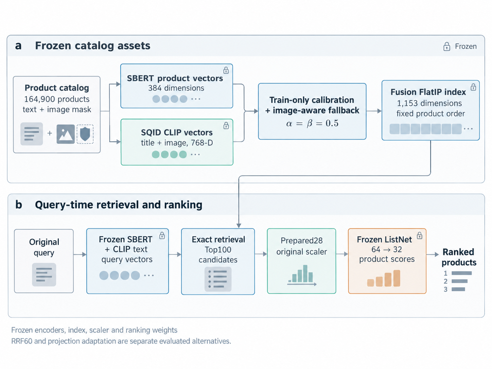
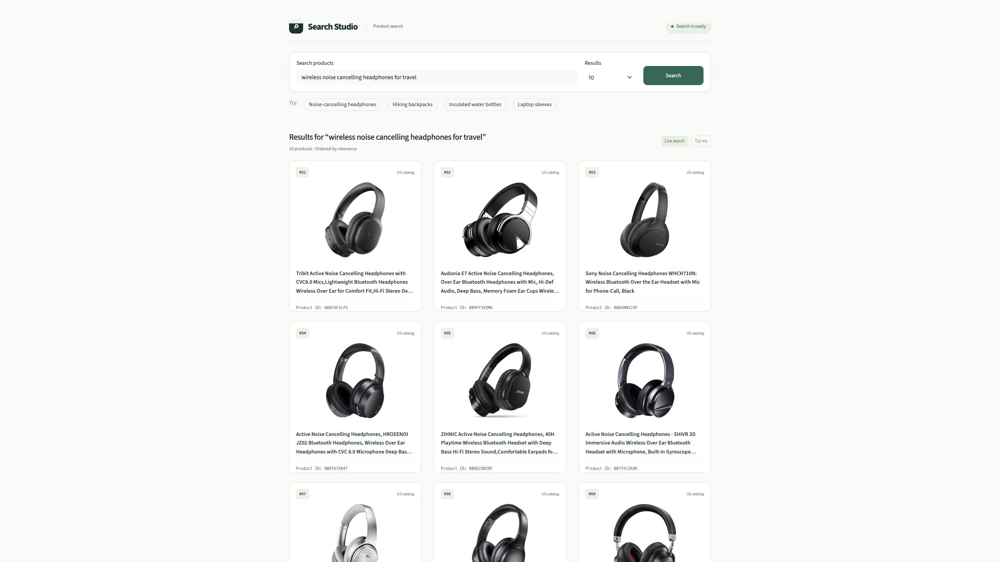

# Multimodal Product Search

A product search system combining exact multimodal retrieval with learning to rank. It searches a frozen catalog of **164,900 products** and serves an English search interface through FastAPI and Streamlit.



The default path is:

```text
Natural-language query → SBERT + CLIP text encoders
→ calibrated, image-aware Fusion FlatIP Top100
→ Prepared28 features → original scaler → frozen ListNet → ranked products
```

The fusion weights are fixed at α = β = 0.5. Product IDs, candidate selection, feature definitions and ranking weights are preserved. The online CLIP checkpoint is accepted on vector and retrieval/ranking compatibility evidence; its exact historical SQID revision remains unverified.

## Project layout

```text
src/product_search/
  artifacts.py          # asset hashes, shapes and dependency checks
  encoders.py           # persistent isolated CPU encoder worker
  retrieval.py          # exact FlatIP search and row-aligned product keys
  lexical.py            # BM25, TF-IDF and original lexical feature definitions
  features.py           # Prepared28 and bounded product-token LRU
  calibration.py        # train-fitted scores and missing-image fallback
  ranking.py            # original scaler, 64→32 ListNet and stable tie breaks
  pipeline.py           # retrieval, feature building and ranking
  service.py            # natural-language search and product serialization
  dispatch.py           # bounded FIFO queue and in-flight request coalescing
  api.py                # /health, /ready and /search
  ui/                   # English storefront, HTTP client and image display cache
  research/             # core offline baselines, metrics and projection study
configs/                # portable external-asset configuration examples
tests/                  # asset-free correctness and lifecycle tests
tools/                  # asset verification and optional exact core regression
```

## Run the demo

Use Python **3.12**. The verified CPU deployment uses four numerical threads and one API worker. Encoder dependencies are isolated because the encoder's NumPy1/Torch environment differs from the NumPy2 ranking core.

```bash
python3.12 -m venv .venv
source .venv/bin/activate
python -m pip install -r requirements.txt
python -m pip install --target .encoder-deps -r requirements-encoder.txt
cp configs/service.example.json configs/service.json
cp configs/encoder_policy.example.json configs/encoder_policy.json
```

Place the existing frozen assets at the paths in those files, or update their paths. Relative paths resolve against the configuration file. The model and index files are external; they are not bundled with this repository. See [asset setup](docs/ASSETS.md).

Start the backend:

```bash
export PYTHONPATH="$PWD/src"
export OMP_NUM_THREADS=4 OPENBLAS_NUM_THREADS=4 MKL_NUM_THREADS=4
export SEARCH_CONFIG="$PWD/configs/service.json"
python -m uvicorn product_search.api:application --factory --host 127.0.0.1 --port 8000 --workers 1
```

In another terminal, start the frontend with the same environment:

```bash
export PYTHONPATH="$PWD/src"
export SEARCH_API_URL=http://127.0.0.1:8000
python -m streamlit run src/product_search/ui/app.py --server.address 127.0.0.1 --server.port 8501
```

Open `http://127.0.0.1:8501`. The UI calls the API and loads product images separately. Missing images, titles and other absent fields remain missing; prices and ratings are never invented.



```bash
curl http://127.0.0.1:8000/ready
curl -X POST http://127.0.0.1:8000/search \
  -H 'Content-Type: application/json' \
  -d '{"query":"wireless headphones for travel","top_k":10}'
```

`top_k` ranges from 1 to 100. Retrieval always uses Top100. Startup verifies the frozen files and fails closed if they are missing or inconsistent; it never downloads substitutes or retrains a model.

## Tests

```bash
python -m pip install -r requirements-dev.txt
python -m pytest -q
ruff check src tests tools
```

Unit tests use small deterministic fixtures and do not need catalog data, labels or checkpoints. An optional [exact regression tool](tools/verify_regression.py) checks external cached query vectors against saved core arrays. [Refactor verification](docs/REFACTOR_VERIFICATION.md) describes the checks performed for this export.

## Research and results

The offline code retains the essential Week2 BM25/TF-IDF and pointwise XGBoost baseline, the Week5 XGBoost/LambdaMART/ListNet comparison and feature groups, scoped ranking/recall metrics, and the evaluated frozen-CLIP projection study. These are separated from the serving path. See [research usage](docs/RESEARCH.md) and the [technical report](docs/Technical_Report.pdf).

Human ESCI judgments and SQID embeddings define the current benchmark. Fixed judged-pool NDCG and full-catalog known-positive recall are separate metrics. Projection adaptation and RRF were research alternatives; neither silently replaces the default Fusion→ListNet system.

The final evaluation did not meet every original ranking improvement target. The report includes the successful and unsuccessful experiments. Historical metadata-based scores use a different benchmark and should not be pooled with ESCI results.

## Concurrency and scope

The dispatcher keeps one active compute job, up to 64 waiting requests, a 9.5 s queue deadline, a 10 s request deadline and an 8,192-product token LRU. Identical in-flight `(query, top_k)` requests can share computation; completed answers and query vectors are not cached. HTTP timeout does not cancel an already running CPU task.

This is a local research demo, not a production hosting service. The repeated local tests observed timeouts under some 64-client workloads. Cached-vector, live-encoder and HTTP timing boundaries remain separate, and measurements from different hardware are not combined. See [performance notes](docs/PERFORMANCE.md).

## Data and model sources

The benchmark uses Amazon ESCI human relevance labels, SQID precomputed CLIP representations, `sentence-transformers/all-MiniLM-L6-v2`, and `openai/clip-vit-large-patch14`. Dataset and model terms apply separately. Full datasets, checkpoints, private configuration paths and relevance labels are excluded from this source export. Runtime search does not need a relevance label file.
