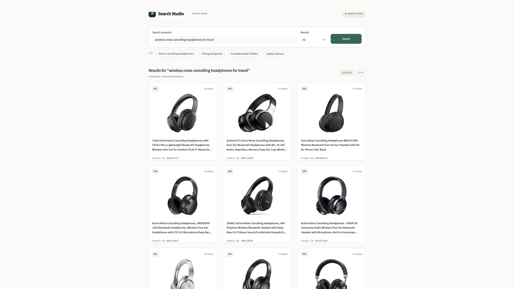
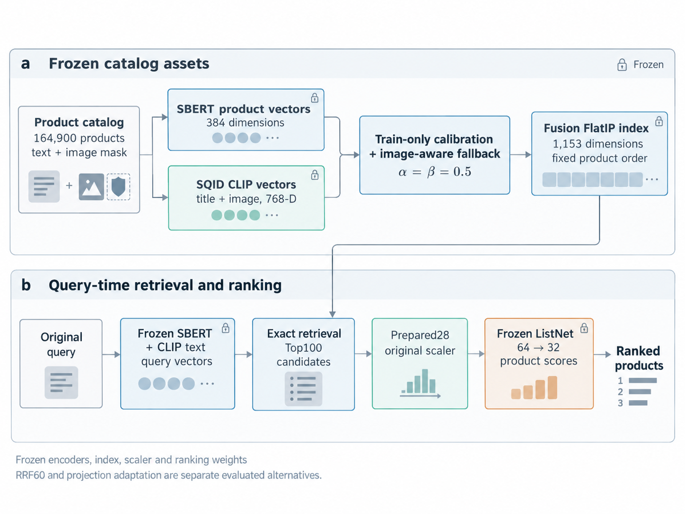

<div align="center">

<h1>Multimodal Product Search</h1>

<p>融合多模态检索与学习排序，提供可交互的自然语言商品搜索演示。</p>

<p>
  <a href="https://github.com/Taddyz6/multimodal-product-search/actions/workflows/tests.yml"></a>
  
  
</p>

<p><a href="README.md">English</a> · <strong>简体中文</strong></p>

<p>
  <a href="docs/Technical_Report.pdf">技术报告（英文）</a> ·
  <a href="#系统架构">系统架构</a> ·
  <a href="#实验结果">实验结果</a> ·
  <a href="#快速启动">快速启动</a>
</p>

</div>

---

## 项目概览

本项目支持通过自然语言搜索 **164,900 件商品**，使用冻结的 SBERT/CLIP 表示进行候选检索，再由学习排序模型生成最终结果。项目基于 **Amazon ESCI + SQID** 开展相关性实验，并通过 FastAPI 后端和英文 Streamlit 页面提供交互演示。

<table>
  <tr>
    <td align="center"><strong>164,900</strong><br>商品目录规模</td>
    <td align="center"><strong>Top100</strong><br>精确检索候选预算</td>
    <td align="center"><strong>28 维特征</strong><br>词汇、语义、图像与元数据</td>
    <td align="center"><strong>CPU 演示</strong><br>实时 Query 编码与排序</td>
  </tr>
</table>

- **多模态检索：** 使用训练数据估计的校准参数融合文本与图像分数，并明确处理缺图商品的回退。
- **学习排序：** 冻结的 28→64→32→1 ListNet 综合词汇、语义、视觉和元数据信号。
- **交互搜索：** 支持自由输入，展示真实商品标题、图片、排名、排序分数及请求耗时。
- **等价推理优化：** 通过行号对齐的候选取数和商品分词缓存，减少重复的全目录处理，并核验计算结果一致性。

## 搜索演示



输入商品名称、品牌或需求描述即可搜索真实目录。商品图片独立加载，缺图时显示占位内容。目录中不存在的价格、评分等字段保持缺失，不生成虚构信息。

## 系统架构



```text
自然语言 Query
        │
        ▼
冻结 SBERT + 通过兼容性验证的 CLIP 文本编码器
        │
        ▼
校准融合 + 缺图掩码回退 · FAISS FlatIP · Top100
        │
        ▼
Prepared28 特征 → 原 Scaler → 冻结 ListNet
        │
        ▼
排序商品 → FastAPI → Streamlit
```

融合权重固定为 **α = β = 0.5**，商品目录、索引、特征顺序、Scaler 和排序权重均保持冻结。在线编码器已通过向量和检索排序结果的兼容性检查；原 SQID CLIP 的精确历史 revision 仍未确认。RRF 和 Projection Adaptation 保留为报告中的研究方案，默认系统继续使用 Fusion→ListNet。

## 实验结果

### 相关性评估

一次性 Final Test 使用 ESCI 人工相关性标签及冻结的 Query/Product 划分。NDCG 在**固定人工标注候选池**中计算，保留所有候选的竞争位置，仅对当前评价范围之外的目标标签进行掩码。Cold-Test 衡量对未参与监督训练的商品 ID 的泛化表现。

| 模型 | Warm NDCG@10 | Cold-Test NDCG@10 | Overall NDCG@10 |
|---|---:|---:|---:|
| BM25 | 0.6660 | 0.3090 | 0.7234 |
| Week2 XGBoost | 0.6740 | 0.3193 | 0.7339 |
| LambdaMART · 28 维特征 | 0.7131 | **0.3320** | 0.7758 |
| ListNet · 28 维特征 · 默认模型 | **0.7163** | 0.3247 | **0.7776** |

加粗表示各列最高点估计。ListNet 在最终评估前根据 Validation 选定，Test 结果不用于切换正式模型。Warm、Cold-Test 和 Overall 的目标范围不同，Overall 不是前两者的算术平均。

在 Warm Test 上，XGBoost 相对 BM25 的 NDCG@10 提升 **1.20%**；LambdaMART 和 ListNet 相对 Week2 XGBoost 分别提升 **5.80%** 和 **6.28%**。ListNet 的 Cold-Test 相对提升为 **1.69%**，配对置信区间跨越 0。原项目的排序提升目标未达到。

全目录检索中，校准 Fusion 的 Warm **Known-Positive Recall@50 为 0.5449**，SBERT 为 **0.4765**，相对提升 **14.35%**。该指标只衡量已知 E/S 正例的覆盖，未标注商品不被赋予负标签，也不以这一召回指标替代固定候选池 NDCG。

[38 页完整技术报告](docs/Technical_Report.pdf)包含置信区间、消融、难例及失败实验，附录 I 简要说明项目中的 AI 辅助使用情况。历史 Metadata 实验使用不同的 Query、标签和评估设置，在报告中单独展示。

### 本地 CPU 性能

测量环境为 **Intel Core i5-1038NG7**、macOS 14.8.7、4 个数值线程和 1 个 API Worker。每个计时层级包含四轮观测，共 4,000 次测量；模型保持加载，商品 LRU 独立执行两遍工作集预热。B/C 的每次请求均实时执行编码器。

| 计时边界 | Mean（ms） | P95（ms） |
|---|---:|---:|
| **A** · 缓存 Query 向量 → 检索与排序 | 102.159 | 204.994 |
| **B** · 实时双编码器 → 排序与商品字段构造 | 164.026 | 337.103 |
| **C** · 客户端 HTTP 发起 → 完整响应 Body | 184.525 | 370.082 |

Mean 为四个轮次均值的平均，P95 从相同条件的原始请求合并后计算。部分 64 客户端负载出现排队超时，两次 Broad 持续负载窗口提前结束。不同计时边界、不同硬件会话分别报告。[性能说明](docs/PERFORMANCE.md)记录了 Burst/Sustained 定义、缓存预热、请求合并及未完成场景。

## 快速启动

已验证的演示环境为 **Intel macOS CPU + Python 3.12**。模型权重、Embedding 和索引由外部路径加载，不随仓库分发。启动前请按照[资产配置说明](docs/ASSETS.md)准备已登记文件。

### 1. 安装与配置

```bash
git clone https://github.com/Taddyz6/multimodal-product-search.git
cd multimodal-product-search

python3.12 -m venv .venv
source .venv/bin/activate
python -m pip install -r requirements.txt
python -m pip install --target .encoder-deps -r requirements-encoder.txt

cp configs/service.example.json configs/service.json
cp configs/encoder_policy.example.json configs/encoder_policy.json
```

更新两个配置文件中的资产路径。相对路径以配置文件所在目录为基准解析，Encoder 依赖与使用 NumPy2 的排序核心隔离安装。

```bash
export PYTHONPATH="$PWD/src"
python tools/verify_assets.py --config configs/service.json
```

### 2. 启动 API

```bash
export PYTHONPATH="$PWD/src"
export OMP_NUM_THREADS=4 OPENBLAS_NUM_THREADS=4 MKL_NUM_THREADS=4
export SEARCH_CONFIG="$PWD/configs/service.json"

python -m uvicorn product_search.api:application \
  --factory --host 127.0.0.1 --port 8000 --workers 1
```

### 3. 启动页面

在另一个终端中激活同一虚拟环境，然后运行：

```bash
source .venv/bin/activate
export PYTHONPATH="$PWD/src"
export SEARCH_API_URL=http://127.0.0.1:8000

python -m streamlit run src/product_search/ui/app.py \
  --server.address 127.0.0.1 --server.port 8501
```

浏览器打开 **http://127.0.0.1:8501**。

<details>
<summary><strong>API 接口与请求示例</strong></summary>

| 接口 | 功能 |
|---|---|
| `GET /health` | 服务、资产和 Dispatcher 状态 |
| `GET /ready` | 就绪检查；所需组件不可用时返回 503 |
| `POST /search` | 自然语言搜索，`top_k` 为 1～100 |

```bash
curl http://127.0.0.1:8000/ready

curl -X POST http://127.0.0.1:8000/search \
  -H 'Content-Type: application/json' \
  -d '{"query":"wireless headphones for travel","top_k":10}'
```

检索始终保留 Top100，显示结果数量不改变候选预算。启动时核验已登记资产，不静默替换模型或重建索引。

</details>

## 工程结构

```text
src/product_search/
├── artifacts.py       # 外部资产身份核验与加载
├── encoders.py        # 常驻的隔离编码 Worker
├── retrieval.py       # 精确 FAISS 检索与商品键对齐
├── lexical.py         # BM25、TF-IDF 与词汇特征定义
├── features.py        # Prepared28 与有界商品分词 LRU
├── calibration.py     # 分数校准与缺图回退
├── ranking.py         # 原 Scaler 与 ListNet 推理
├── pipeline.py        # 检索 → 特征 → 排序
├── service.py         # 自然语言搜索与商品字段构造
├── dispatch.py        # 有界请求准入与在途计算合并
├── api.py             # FastAPI 应用
├── ui/                # 英文 Streamlit 页面与 HTTP 客户端
└── research/          # 离线 Baseline、指标与 Projection 实验

configs/               # 可移植的资产配置示例
docs/                  # 报告、架构、配置与核验说明
tests/                 # 小规模正确性与生命周期测试
tools/                 # 资产检查与精确回归工具
```

<details>
<summary><strong>研究代码与服务配置</strong></summary>

离线模块保留 Week2 词汇检索与 Pointwise Baseline、Week5 XGBoost/LambdaMART/ListNet 对照、特征组消融、分范围评估和冻结 CLIP 的 Projection 实验，与服务推理分开。具体见[研究代码说明](docs/RESEARCH.md)及[28 维特征定义](docs/FEATURES.md)。

Dispatcher 采用单计算槽，队列容量和 Waiter 上限均为 64，排队期限为 9.5 秒，请求期限为 10 秒，商品分词 LRU 容量为 8,192。相同的在途 `(query, top_k)` 请求可以共享计算；不缓存完整搜索答案或 Query 向量，HTTP 超时也不会取消已经开始的 CPU 计算。

</details>

## 正确性验证

**本地 45 项测试通过。** 20 条无标签 Validation Query 的重构检查覆盖候选、全部 28 维特征、Scaler 输出、ListNet 分数及完整排序，均与锁定参考逐位一致。另有 3 条相同执行条件下的实时 Query 检查，与原批准编码实现一致。

```bash
python -m pip install -r requirements-dev.txt
python -m pytest -q
ruff check src tests tools
ruff format --check src tests tools
```

单元测试使用小规模样例，不需要商品目录、相关性标签或模型权重。详见[重构核验记录](docs/REFACTOR_VERIFICATION.md)和可选的[外部资产回归工具](tools/verify_regression.py)。

## 文档导航

| 文档 | 内容 |
|---|---|
| [完整技术报告](docs/Technical_Report.pdf) | 方法、最终评估、难例与系统性能 |
| [LaTeX 源码包](docs/Technical_Report_Source.zip) | 可编译的报告源码、图片、参考文献及 AI 辅助使用说明 |
| [资产配置](docs/ASSETS.md) | 所需文件、哈希、Checkpoint 与配置路径 |
| [特征说明](docs/FEATURES.md) | 原始 28 维特征的定义与顺序 |
| [研究代码](docs/RESEARCH.md) | Baseline、消融与评估边界 |
| [性能说明](docs/PERFORMANCE.md) | 计时层级、负载与缓存协议 |
| [重构核验](docs/REFACTOR_VERIFICATION.md) | 结果一致性检查与运行范围 |

Amazon ESCI、SQID、SBERT 和 CLIP 分别适用其数据或模型条款。完整数据、模型权重、相关性标签和个人配置路径不包含在源码仓库中。详见[来源与归属说明](NOTICE.md)。
